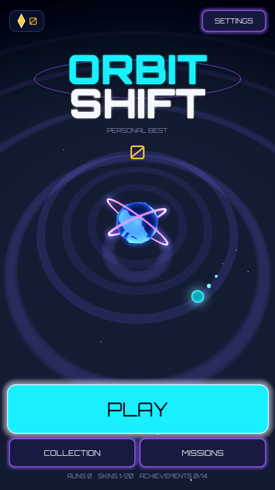
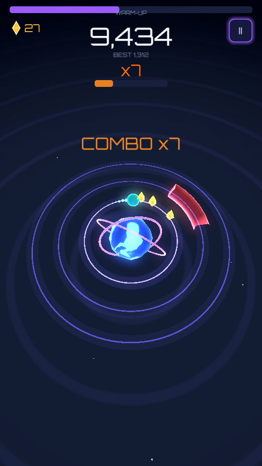
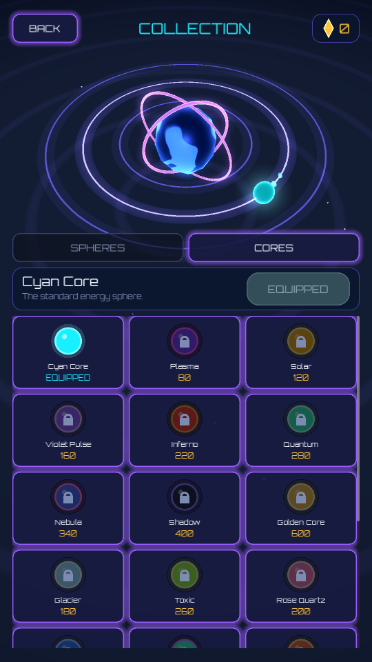

# ORBIT SHIFT — Final Beta (0.9.0-beta, build 1)

**One finger. Three orbits. One mistake.** A neon sci-fi 3D arcade game for mobile, built with Godot 4.3 / GDScript.
You steer an energy sphere that orbits a central core on its own; you only choose the orbit. Dodge obstacles,
collect crystals, chain combos, unlock cosmetics.

  

## Status (honest summary)
| Item | State |
|---|---|
| Godot project, all scenes, scripts, shaders, assets | **Complete** |
| Gameplay (orbits, obstacles x4 kinds, crystals, combo, difficulty, pause/resume) | **Complete, tested** |
| UI (splash, menu, HUD, pause, results, collection, missions/achievements, settings, tutorial) | **Complete** |
| Progression (20 skins, 5 cores, missions, daily missions, 14 achievements, stats, save) | **Complete, tested** |
| Audio (15 SFX + 2 music loops, procedurally synthesized, original) | **Complete** |
| Automated tests | 67 unit tests + 35 integration checks, all passing — see `docs/TESTING.md` |
| **Android APK** | **NOT built in the delivery environment** (Android SDK download is blocked there). The project builds with one command on your machine: `docs/INSTALL_AND_BUILD.md` |
| iOS | Export preset prepared; needs macOS + Xcode (untested) |
| Physical-device testing (FPS, safe areas, lock-screen behaviour) | **Not done** — see `docs/KNOWN_LIMITATIONS.md` |

## Quick start
1. Install **Godot 4.3.x** (standard build, not .NET).
2. `godot --path . --import` (or open `project.godot` in the editor once) and press **F5**.
   On desktop: click left/right half of the window, or use **← / →** (Space = outer, Esc = pause).
3. Build the APK: `ANDROID_SDK=... GODOT=... ./tools/build_android.sh` (details in `docs/INSTALL_AND_BUILD.md`).
4. Run tests: `godot --headless --path . -s tests/run_tests.gd` and `godot --headless --path . -s tests/integration_run.gd`.

## Controls
* **Split Tap (default):** tap left half = one orbit inward, right half = one orbit outward.
* **One Tap:** every tap moves one orbit in the current direction and bounces at the edges (0→1→2→1→0).
Switch in *Settings → Controls*. Taps during a transition retarget instantly; limits are hard clamps.

## Documentation
`docs/GDD.md` · `docs/ARCHITECTURE.md` · `docs/INSTALL_AND_BUILD.md` · `docs/EXPORT_CONFIG.md` · `docs/FEATURES.md` ·
`docs/TESTING.md` · `docs/KNOWN_LIMITATIONS.md` · `docs/ROADMAP.md` · `docs/ASSET_CREDITS.md`

## Project layout
`scenes/` thin scene files + screen controllers · `scripts/` logic by domain (core, orbital, obstacles, scoring,
progression, missions, achievements, audio, ui, save, gfx) · `shaders/` · `assets/` (models baked from procedural
generators, icons, fonts, audio) · `resources/difficulty.json` · `tests/` · `tools/` (asset generators, screenshot/flow tools) · `export/`.
